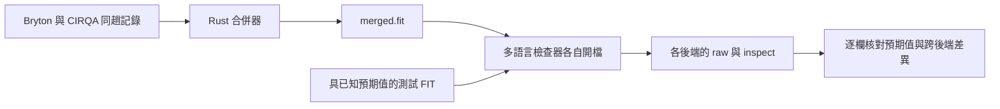

# 多語言 FIT 檢查器與單一 Rust 合併器分別驗收

## 狀態

accepted。2026-11-23 使用者確認此專案開發檢查器與合併器兩類 CLI，兩者各有規格、驗收情境與案例。使用者希望檢查器涵蓋越多語言越好，點名 Python、C#、Rust、Node.js。合併器只維護一套 Rust 實作。

## 背景

驗證讀取能力時，需讓不同解碼器各讀同一份 FIT，才能找出解讀差異。合併同趟活動時，則需依同一套品質與來源規則，從多個裝置的記錄選出發佈值。

## 決策

四種語言的檢查器共用輸出契約與樣本，分別記錄所用 SDK 與可驗證的能力。之後可以相同方式增加語言。macOS 上的 Rust 合併器負責配對、選源、寫出與發佈。其輸出可再作為各檢查器的輸入。[檢查器規格](../spec/inspector.md) · [合併器規格](../spec/merger.md)

## 影響

檢查器依各後端的實際結果驗收。合併器的品質判定與發佈行為只有一份產品契約，測試時可借用獨立檢查器讀回產物。日常合併沿用現有 Rust CLI 設計，開發驗證可分別執行四種語言。

## 替代方案

用同一個解碼器產生所有語言的報告會使共用解碼問題難以被發現。以多種語言各寫一份合併規則則會增加行為分歧與維護成本。

## 後續工作

Python、C#、Rust 已用相同實檔逐項比對並追加重新編碼驗收。Node.js 仍待開發，M2 合併器於使用者驗收檢查器後啟動。[往返決策](2026-11-23-inspector-roundtrip.md) · [檢查器驗收案例](../spec/testcases/inspector.md) · [合併器驗收案例](../spec/testcases/merger.md)
